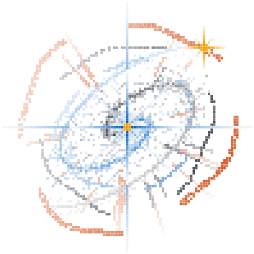

<p align="center">
  <picture>
    <source media="(prefers-color-scheme: dark)" srcset="assets/logo/nova-mark-dark.svg">
    
  </picture>
</p>

# Nova

> A minimal, pi-and-crush-inspired agent harness in Go — built to be embedded in
> Go applications (her-go, polaris, ivy) or run standalone as a CLI/TUI.

**Status: planning.** No library code is being written yet. The repository
contains the plan and design documents, plus an early M0 prototype at the
repository root that was built to validate the loop and provider design (see
[`docs/SPIKE.md`](docs/SPIKE.md)). The prototype is exploratory; its API is not
frozen.

## What Nova is

Nova is **two Go programs in one repo**, with a strict dependency direction:
the frontend imports the backend, and the backend never imports a UI library.

### Nova — the backend (library + headless CLI)

The reusable primitive layer. Imported by programs that need an agent loop
(her-go, polaris, ivy) and by the frontend. **Zero UI dependencies.**

- a small **agent loop** (`request → tool calls → results → repeat`) with hooks;
- a **tool registry** you extend without modifying the core, using both Go code
  and declarative YAML/Markdown manifests;
- a **pluggable provider layer** with OpenRouter as the first provider and a
  generic OpenAI-compatible implementation underneath it;
- built-in **core tools** (`read`, `write`, `edit`, `list`, `glob`, `grep`,
  `bash`);
- **sessions** (a JSONL message tree) and **compaction**;
- an in-process **extension API**;
- a **headless CLI** for scripting and CI (`nova-run`: one prompt, print/JSON).

### Nova agent — the frontend (coding agent)

The standalone coding agent. A separate program that consumes the backend
primitives and adds the terminal experience, built on the
[`charm.land`](https://charm.sh) stack and modeled on
[crush](https://github.com/charmbracelet/crush).

- an interactive **Bubble Tea TUI**: streaming transcript, tool-call cards,
  diff views, slash commands, model picker, session list;
- per-tool renderers and a themeable, keyboard-first design;
- the flagship binary (`nova`).

The two communicate through a small, transport-agnostic interface. Today that
interface is an in-process Go call; it is designed so an RPC/daemon mode can be
added later without changing the frontend.

The architecture is modeled on [pi](https://github.com/earendil-works/pi):
minimal to start, easy to extend, and useful out of the box.

## Layout

One GitHub repo — `github.com/AutumnsGrove/nova` — containing two Go modules
tied together with `go.work`. The backend is the repo root; the frontend is a
nested module in `tui/` (its release tags are subdirectory-prefixed:
`tui/vX.Y.Z`).

```
nova/                          repo root, module github.com/AutumnsGrove/nova
  go.mod                       backend module
  go.work                      use . and ./tui
  message/ provider/ tool/     backend packages
  tools/ agent/ session/       backend packages
  compaction/ extension/ config/
  cmd/nova-run/                headless CLI (print/JSON)
  docs/
  tui/                         nested module github.com/AutumnsGrove/nova/tui
    go.mod
    cmd/nova/                  interactive coding agent (binary: nova)
    ...                        charm.land TUI code
```

## North star

One day, a **full coding harness on par with pi** — our own, same principles. It
is reached in two pieces: the **backend** grows into a complete primitive layer
(loop, tools, sessions, compaction, extensions), and the **frontend** grows into
a polished daily coding agent on the charm.land stack. Any Go program can embed
the backend; only the frontend pays for the UI.

## Why

her-go, polaris, and ivy each implement (or are about to implement) the same
agentic substrate: an LLM tool-calling loop, a tool registry, tool descriptions,
session/context management, and streaming. her-go already extracted a shared
`agent_engine`; polaris has a large bespoke research loop; ivy's "Ask Ivy" loop
is planned but unbuilt. Nova is that substrate, factored out once, so a new Go
program can add an agent loop by importing a package instead of recreating the
wheel.

## Documents

| Document | Contents |
|---|---|
| [`docs/PLAN.md`](docs/PLAN.md) | Vision, principles, milestones (backend and frontend), open questions. |
| [`docs/ARCHITECTURE.md`](docs/ARCHITECTURE.md) | The two programs, module layout, core interfaces, data flow, concurrency, error model. |
| [`docs/DESIGN.md`](docs/DESIGN.md) | Decision log, the ecosystem survey, and what we borrow from where. |
| [`docs/INTEGRATION.md`](docs/INTEGRATION.md) | How her-go, polaris, and ivy embed the backend. |
| [`docs/SPIKE.md`](docs/SPIKE.md) | What the M0 prototype proves, and its known limitations. |
| [`docs/BRAND.md`](docs/BRAND.md) | The two logo marks, the palette, and how to regenerate them. |

## Name

**Nova** — a star that suddenly brightens. Astral, short, and in the same family
as `polaris`, `her-go`, and `ivy`. The module path is
`github.com/AutumnsGrove/nova`.

## Inspirations

Two projects shape Nova:

- **[pi](https://github.com/earendil-works/pi)** — the *architecture*. A small
  agent loop, hooks at every stage, a tool/provider extension model, a session
  tree, and a minimal core that grows rich through extension.
- **[crush](https://github.com/charmbracelet/crush)** — the *experience*. A
  gorgeous, fast, keyboard-driven terminal agent built on the `charm.land`
  libraries. Nova uses the same stack for its frontend so the result feels as
  good as it works.

## Lineage

Nova borrows deliberately:

- from **pi** — the agent loop and hooks, the tool/provider extension model, the
  session tree, and the minimal-core philosophy;
- from **crush / charm.land** — the terminal design language and the frontend
  stack (Bubble Tea, Lipgloss, Bubbles, Glamour, Log);
- from **her-go** — the shared loop with lifecycle hooks, YAML tool manifests,
  continuation windows, and the OpenAI-compatible client shape;
- from **polaris** — concurrent tool dispatch with panic isolation, pseudo
  tool-call recovery, and research nudges as hooks;
- from **ivy** — the provider-as-chokepoint idea (its `llm.Gate` enforces
  policy, caps, and ledger as a provider decorator).
