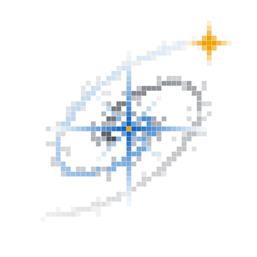

# Nova — Brand

Two marks are locked in (2026-10-09), both drawn from square cells:

| | Full mark | Minimal mark |
|---|---|---|
| Design | **Q2**: layered shells, spikes, filaments, dust | **K3**: star, spiral, companion |
| Grid | 97 by 97 cells | 49 by 49 cells |
| Use | README banner, docs, posters, the TUI splash | Icons, avatars, small sizes, the TUI header |

<picture>
  <source media="(prefers-color-scheme: dark)" srcset="../assets/logo/nova-mark-dark.svg">
  
</picture>
<picture>
  <source media="(prefers-color-scheme: dark)" srcset="../assets/logo/nova-mark-min-dark.svg">
  
</picture>

## What it is

A nova is a white dwarf in a close binary that pulls gas off its companion until
the gas ignites. The star flares thousands of times brighter, throws off a shell
of hot gas, and survives. The full mark draws the outburst: a blazing cell star
with long diffraction spikes, broken shells of ejected gas around it (warm red,
grey, and blue), thin radial filaments, a dust lane, and a warm companion star
that survived. The minimal mark keeps the star, the spiral of ejecta, and the
companion.

The warm companion against the cool primary is the one idea both marks share. It
is always the warmest and brightest element.

Every cell is a square, so the same artwork renders as a terminal splash screen
(one half-block character per cell) and as an SVG at any size.

## Files

| File | Use |
|---|---|
| `assets/logo/nova-mark-dark.svg` / `-light.svg` / `-mono.svg` | Full mark on dark, on light, and in one colour |
| `assets/logo/nova-mark-min-dark.svg` / `-light.svg` / `-mono.svg` | Minimal mark, same three versions |
| `assets/logo/nova-icon.svg` | Minimal mark on a rounded tile: app icon, GitHub avatar |
| `assets/logo/gen/main.go` | The generator. Never edit the SVGs by hand. |

Regenerate with `go run ./assets/logo/gen`. The generator is seeded, so the
output is identical on every run. The full mark SVGs are about 135 KB each
because every cell is a rectangle.

## Palette

| Role | Dark | Light | Where it appears |
|---|---|---|---|
| `spark` | `#62c6ff` | `#0b64c0` | Primary star, first arm, innermost shell |
| `ink` | `#f2f6fb` | `#101722` | Second arm, dust, middle shell |
| `core` | `#fff4cf` | `#f0a000` | Star centres, companion |
| `warm` | `#ff9a5c` | `#d4501a` | Outer shell, filaments |
| Icon tile | | `#0b64c0`, cells `#f4f6f9`, core `#ffd25a` | |

These four roles become the TUI theme's accent, text, highlight, and warm tokens,
so the product and the logo share one palette.

## Rules

- Do not smooth the cells, outline them, or add gradients.
- Use the full mark at 200 px and above. Below that, use the minimal mark.
- Below about 40 px even the minimal mark stops reading its spiral. A favicon
  variant (the star alone, plus one warm cell) is a separate task.
- The wordmark is lowercase `nova`, set in a monospace face. In prose, the name is
  `Nova` with only the N capitalised.

## Splash direction (chosen 2026-10-13)

The terminal splash is no longer a downscale of the full mark. It is a short animation drawn on the character
grid: a slash-filled `nova` wordmark on the left, a star on the right that ignites as the name slides in, a
shell of ejected gas that cools from blue to orange, and a field of twinkling stars, held on screen with the name
still shimmering. It uses the same four palette roles. The mockups are in [`mockups/splash/`](mockups/splash/README.md)
and the build is specified in [`chunks/C21-splash-sequence.md`](chunks/C21-splash-sequence.md). The README banner
is an animated GIF of the same `splash.Cells` render, regenerated with
`go run ./tui/splash/splashgif` whenever `tui/splash` moves pixels; the full and minimal marks above still
serve icons and avatars.

## Still to do

- Favicon variant for 16 to 32 px.
- A reference illustration of an actual nova (a close binary, then the outburst)
  was drawn during the design work and is not in the repo.
